<div align="center">

<picture>
  <source media="(prefers-color-scheme: dark)" srcset="assets/banner-dark.svg">
  
</picture>

<br>

[](https://github.com/3zz2004/Wasta/actions/workflows/ci.yml)
[](https://www.npmjs.com/package/wasta)
[](https://pypi.org/project/wasta/)
[](js/package.json)
[](LICENSE)

**Phone numbers, national IDs, tafqeet, governorates and Arabic text.**<br>
The small, fiddly things every Egyptian codebase ends up rewriting, done once and done properly.

[Phones](#mobile-numbers) · [National IDs](#national-ids) · [Tafqeet](#tafqeet) · [Governorates](#governorates) · [Arabic text](#arabic-text-normalization) · [بالعربي](#بالعربي)

</div>

## Install

```bash
npm install wasta
pip install wasta
```

JavaScript and Python, with the same behaviour in both. Zero dependencies. Everything runs on your machine: nothing is sent anywhere and nothing is stored.

<p align="center">
  
</p>

---

## What's inside

| | JavaScript | Python |
|---|---|---|
| Mobile numbers | `parsePhone` · `isValidPhone` | `parse_phone` · `is_valid_phone` |
| National IDs | `parseNationalId` · `isValidNationalId` | `parse_national_id` · `is_valid_national_id` |
| Amounts in words | `tafqeet` · `numberToArabicWords` | `tafqeet` · `number_to_arabic_words` |
| Governorates | `governorates` · `findGovernorate` · `getGovernorate` | `GOVERNORATES` · `find_governorate` · `get_governorate` |
| Arabic text | `normalizeArabic` · `toWesternDigits` · `toArabicDigits` | `normalize_arabic` · `to_western_digits` · `to_arabic_digits` |

---

## Mobile numbers

Accepts the way people actually type numbers: with or without `+20` / `0020`, with spaces, dashes or brackets, in Arabic-Indic digits, and with the invisible direction marks that come along when you copy from Arabic text.

```ts
import { parsePhone } from "wasta";

parsePhone("+20 100 123 4567");
// { ok: true, value: { national: "01001234567", e164: "+201001234567", prefix: "010", operator: "vodafone" } }

parsePhone("٠١٢٩٨٧٦٥٤٣٢"); // { ok: true, value: { …, operator: "orange" } }
parsePhone("0223456789");   // { ok: false, error: "NOT_MOBILE" }
```

```python
from wasta import parse_phone, InvalidPhoneError

parse_phone("+20 100 123 4567")
# MobileNumber(national='01001234567', e164='+201001234567', prefix='010', operator='vodafone')

try:
    parse_phone("0223456789")
except InvalidPhoneError as e:
    e.code  # 'NOT_MOBILE'
```

Error codes: `EMPTY` · `INVALID_CHARACTERS` · `NOT_EGYPTIAN` · `NOT_MOBILE` · `INVALID_LENGTH` · `UNKNOWN_PREFIX`

> `operator` is the network that owns the prefix (`010` Vodafone, `011` Etisalat, `012` Orange, `015` WE). Egypt has number portability, so treat it as a hint, not a fact about the subscriber.

## National IDs

Reads what's encoded in the 14 digits: birth date, governorate and gender.

```ts
import { parseNationalId } from "wasta";

const result = parseNationalId("29905211201538");
if (result.ok) {
  result.value.birthDate;           // "1999-05-21"
  result.value.governorate?.nameAr; // "الدقهلية"
  result.value.gender;              // "male"
}
```

```python
from wasta import parse_national_id

info = parse_national_id("29905211201538")
info.birth_date  # datetime.date(1999, 5, 21)
info.governorate.name_en  # 'Dakahlia'
```

Error codes: `INVALID_FORMAT` · `INVALID_CENTURY` · `INVALID_BIRTH_DATE` · `FUTURE_BIRTH_DATE` · `UNKNOWN_GOVERNORATE`

People born outside Egypt have governorate code `88`: `bornAbroad` is `true` and `governorate` is `null` / `None`.

> The last digit is a check digit, but its algorithm has never been officially published. wasta does not pretend to verify it. A number that passes here is well-formed, not necessarily issued.

## Tafqeet

Amounts in words, the way they're written on invoices and cheques.

```ts
import { tafqeet, numberToArabicWords } from "wasta";

tafqeet(1500.25);   // "فقط ألف وخمسمائة جنيه وخمسة وعشرون قرشًا لا غير"
tafqeet("١٬٥٠٠");    // "فقط ألف وخمسمائة جنيه لا غير"
tafqeet(2000, { wrap: false }); // "ألفا جنيه"

numberToArabicWords(250000); // "مائتان وخمسون ألفًا"
```

```python
from wasta import tafqeet
from decimal import Decimal

tafqeet(Decimal("11500"))  # 'فقط أحد عشر ألفًا وخمسمائة جنيه لا غير'
tafqeet(1500.25, wrap=False)
```

The grammar is handled properly, not with string concatenation:

| Amount | Output |
|---|---|
| 2 | جنيهان |
| 3 | ثلاثة جنيهات |
| 11 | أحد عشر جنيهًا |
| 200 | مائتا جنيه |
| 2000 | ألفا جنيه |
| 11000 | أحد عشر ألف جنيه |
| 11500 | أحد عشر ألفًا وخمسمائة جنيه |

Amounts with more than two decimal places throw `TOO_MANY_DECIMALS` instead of being rounded. Silently changing a sum of money is worse than an error. Supported range: 0 to 999,999,999,999.

## Governorates

All 27, with the two-digit codes used in national IDs, Arabic and English names, and a lookup that forgives the way people really spell them.

```ts
import { findGovernorate, governorates } from "wasta";

findGovernorate("كفرالشيخ")?.code;          // "15"
findGovernorate("محافظة كفر الشيخ")?.code;  // "15"
findGovernorate("Kafr-El-Sheikh")?.code;   // "15"
findGovernorate("Sharkia")?.nameAr;        // "الشرقية"

governorates.map((g) => ({ value: g.slug, label: g.nameAr })); // ready for a <select>
```

## Arabic text normalization

For search and matching, so "أحمد" finds "احمد" and "مدرسة" finds "مدرسه".

```ts
import { normalizeArabic } from "wasta";

normalizeArabic("إِنَّ المَدرسـةَ  كبيرة"); // "ان المدرسه كبيره"
normalizeArabic("مدرسة", { taMarbuta: false }); // "مدرسة"
```

| Option (JS / Python) | Default | Effect |
|---|---|---|
| `diacritics` | on | removes tashkeel |
| `tatweel` | on | removes ـ |
| `alef` | on | أ إ آ ٱ → ا |
| `alefMaqsura` / `alef_maqsura` | on | ى → ي |
| `taMarbuta` / `ta_marbuta` | on | ة → ه |
| `hamza` | off | ؤ → و, ئ → ي |
| `digits` | on | ٠١٢ → 012 |
| `whitespace` | on | collapses and trims |

This is lossy on purpose. Use it to build search keys, never on text you show back to users.

---

## Design

**One source of truth.** Governorates and mobile prefixes live once, in [`data/`](data). A script generates the JS and Python copies, and CI fails if they drift.

**One spec, two languages.** Every behaviour is pinned down in [`spec/`](spec) as plain JSON test vectors, and both test suites run against the same files. If the JS and Python packages ever disagree, the build breaks.

**Idiomatic in each language.** JavaScript returns a `Result` you check with `if (result.ok)`; Python raises exceptions that subclass `ValueError`. Error codes are identical in both, so you can share handling logic across a stack.

**Honest about limits.** Where Egypt doesn't publish a rule (ID check digits, operator after porting), wasta says so instead of guessing.

## Contributing

Spotted a wrong spelling, a missing alias or a tafqeet case that reads badly? Open an issue, or add the case to `spec/` and send a PR: a failing test vector is the best bug report. See [CONTRIBUTING.md](CONTRIBUTING.md).

---

<div dir="rtl">

## بالعربي

**wasta** مكتبة صغيرة بتحل الحاجات اللي كل مبرمج مصري بيكتبها من الأول في كل مشروع:

- **أرقام الموبايل:** بتقبل الرقم بأي شكل (`+20`، مسافات، شرَط، أرقام عربية) وترجّعه بصيغة موحّدة مع الشبكة.
- **الرقم القومي:** بتطلّع تاريخ الميلاد والمحافظة والنوع.
- **التفقيط:** بتكتب المبلغ بالحروف بقواعد اللغة الصح، زي «مائتا جنيه» و«أحد عشر ألفًا».
- **المحافظات:** الـ ٢٧ محافظة بالعربي والإنجليزي، والبحث بيستحمل أي طريقة كتابة.
- **تطبيع النص العربي:** علشان البحث يلاقي «أحمد» لما حد يكتب «احمد».

متاحة لـ JavaScript و Python بنفس السلوك بالظبط، ومن غير أي dependencies، وكل حاجة بتشتغل على جهازك ومفيش أي بيانات بتتبعت لأي مكان.

لو لقيت غلطة في الإملاء أو حالة تفقيط مش مظبوطة، افتح issue.

</div>

## License

[MIT](LICENSE) © Ezz Eldeen Mohamed Hassan
